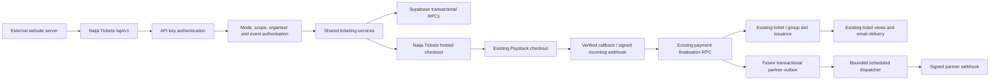

# Naija Tickets integrations — Phase 0 architecture review

Status: historical Phase 0 design review. Phases 1–3 were subsequently approved; Phase 3 code is implemented with sandbox acceptance pending. See integrations-progress.md and integrations-phase3.md for current status. Audit date: 13 October 2026, Africa/Lagos. Repository baseline: `5db773c`. This is a design proposal, not an implemented public API. No application, dependency, database, secret or deployment changes were made during this phase.

## 1. Outcome and scope

Extend the current application with a versioned, organiser-scoped integration boundary. Keep one inventory, payment, issuance and admission engine. Start with server-side credentials, event reads and hosted checkout, then add outgoing webhooks and a widget. Do not expose the existing internal routes wholesale or create a second ticket ledger.

The existing marketplace works through Supabase transactions and Paystack. It is a sound reuse foundation, but passing the current tests is not evidence that a partner platform is production ready. Credentials, developer permissions, sandbox isolation, request idempotency, distributed rate limits and durable outgoing delivery are new work.

### Architecture

The last three outbox/delivery nodes are Phase 4 additions. A widget is a Phase 5 read/selection surface that opens this same hosted checkout in a top-level browser context. Public widget identifiers never authorise private operations.

## 2. Existing system inventory and evidence

| Area | Actual implementation | Reuse or limitation |
| --- | --- | --- |
| Framework | React 19.2.6, TypeScript 5.9.3, Next-compatible `app/` routes implemented by Vinext 1.0.0-beta.5; Vite 8.0.13; Tailwind 4 | This is not a conventional `next build` deployment. Preserve route conventions and RSC behaviour. |
| Hosting | `vercel.json` selects Nitro; `vite.config.ts` uses Vinext Node development and Nitro production builds; Node 24.x | `/api/v1/.../route.ts` fits. Keep payment and image routes in Node; do not switch to Edge. |
| Legacy hosting | Explicit `NAIJA_RUNTIME=cloudflare` branch retains Sites/Workers configuration | Native Sharp email rendering cannot run there. This proposal targets the working Vercel/Node path. |
| Auth | `lib/supabase/client.ts`, `server.ts`, `account-fetch.ts`: browser Supabase sessions, verified JWT via `auth.getUser`, refreshed bearer requests | Keep customer/organiser JWTs. Introduce machine credentials only on the new API boundary. Anonymous auth users are rejected by the account helper. The auth bootstrap creates a customer profile/role; Google OAuth is delegated to Supabase and checks provider availability. |
| Organisation ownership | `organisers`, `organiser_memberships`, `events.organiser_id`; `lib/organiser-account.ts` | Event access is membership-based. Membership `title` is text, not a structured credential-management permission. `ensureOrganiser` can provision an account; never invoke it from a machine-key request. |
| Verification | `organiser_verification_requests`, NIN/CAC submission and admin review; migrations `202609200007`, `202609200008`, `202609230001` | Keep identity documents and references out of partner schemas. Current unverified rules are free-only, maximum two active events, 100 admissions per event, no promo or featured/trending eligibility, and one membership. Do not bypass them. |
| Event editor | `components/organiser-event-editor.tsx`, `lib/organiser-event.ts`, organiser events route, `save_organiser_event_v2` | Atomic event/tier/schedule/policy save. API event writes are not part of the initial phases. Explicitly select an authorised organisation rather than relying on the helper's first membership. |
| Catalogue | `lib/database-events.ts`, `events.ts`, `supabase/public-events-server.ts`; `202609260001` | Published, not-ended events are public; history remains for customers/admins. `publicEventSelect` is useful internally but is too broad to become the partner response contract. |
| Pricing | Integer kobo; standard/early bird prices, deadline and quantity; `202610100001`, `202609170002`; promos `202609200001` | Server-priced checkout is authoritative. Early bird allocations count packages; sold/refunded bookings retain their quota, expired live holds do not. Add read adapters/shared pricing helpers rather than an independent calculation engine. |
| Capacity | `ticket_types.quantity_total/sold/reserved`, `reservations`; `202609260002`, `202609260003` | Counters and holds count individual admissions. Order item `quantity` counts packages, with immutable `admissions_per_ticket` snapshot. Two group-of-five packages consume ten admissions. |
| Checkout | `/checkout/[slug]`, `CheckoutFlow`, `POST /api/checkout/reservations`, `create_checkout_reservation_v3` | Validates buyer/attendees, selections, promo and limits. Ten-minute reservations. No request-level partner idempotency or durable hosted checkout session currently exists. |
| Customer data | `profiles`, `orders.customer_id`, purchaser snapshots, `order_items.attendee_data`, `tickets`; `/api/customer/account` | Guest orders are valid. Customer history is scoped to verified signed-in users. Partner credentials must never substitute a caller-supplied customer ID for authentication. |
| Payment start | `/api/payments/paystack/initialize`, `prepare_paystack_payment`, `complete_free_checkout`, `lib/paystack.ts` | A 32-byte checkout secret is hashed in the DB; stored totals determine Paystack amount. Zero-total bookings use the existing free finaliser. Card details stay with Paystack. |
| Payment verification | `/payment/callback`, `/api/payments/paystack/webhook`, `lib/payments.ts`, `finalize_paystack_payment` | Callback verifies with Paystack; webhook checks HMAC-SHA512 of raw bytes. Amount/currency checks, order/payment locks, provider-event dedupe and idempotent issuance already exist. A redirect parameter is never payment proof. |
| Issuance/QR | `issue_checkout_tickets`, `tickets`, unique `(order_item_id, attendee_index)`; `ticket-artwork.tsx`, `qrcode.react`/`qrcode` | QR currently encodes the unique `NT-...` display code, not `qr_token_hash`. Reuse this format and admission records; do not mint partner-specific tickets. |
| Group claims | `group_bookings`, slot `claim_state`, `/api/group-bookings/[token]`, `claim_group_ticket` | Payment creates sold unclaimed slots without codes. Claims serialise under locks; normalised email OR phone duplicates are rejected. Different email AND phone cannot identify the same human; no stronger identity proof is implemented. |
| Ticket access | `/payment/status`, `order-tickets.server.ts`, `order-ticket-access.ts`, `/group-ticket/[token]` | Order reference is a private bearer capability; group invite and personal ticket token have different privileges. Never place these capabilities in partner return URLs or general API logs. |
| Delivery | `ticket-delivery.ts`, `claim_ticket_delivery_v3`, `complete_ticket_delivery`, `/api/tickets/email`, Resend | Verified payment gates receipts; recipient comes from the original order; claims/cooldown/provider idempotency prevent routine duplicates. Buyer receives the receipt; group claim supplies a personal ticket page. A separate attendee-email-on-claim worker was not found. |
| Entry | `/api/entry/verify`, `/api/entry/staff`, `verify_event_entry`, `202609300001` | Authorises owning organisers or assigned staff before lookup; locks order/ticket and enforces one admission. An organiser cannot scan another organiser's event. Do not fake `p_staff_id` for an integration. |
| Money routing | Payout accounts/subaccounts, initialization split fields, `202609160002`, `202609290001` | Service fee is the platform share, not a new partner commission. Without a connected organiser account the whole payment goes to the platform account. Live settlement reconciliation is page-triggered, not scheduled. |
| Refunds | `/api/admin/refunds`, `record_admin_refund`, incoming refund webhooks, `202609250001` | Admin records a Paystack refund after fetching/verifying its existing ID; the app does not currently initiate a provider refund. Completed full refunds invalidate tickets. Initial partner refund capability should be status reads only. |
| Analytics | Organiser/admin SQL aggregates and protected routes | Retain authoritative verified-payment reports. Test and live business data are not separated throughout the existing reporting pipeline; payout import explicitly checks live domain. |
| Administration | Separate HMAC-signed HttpOnly, Secure-in-production, SameSite Strict cookie; private admin settings/accounts | Actual admin login is not Supabase organiser login. Password storage uses salted single-round SHA-256; failed login delay is not rate limiting. Hardening must be separately planned before broad partner launch. |
| Security/data policies | RLS migrations; private security-definer RPC grants restricted to service role; public/member helper policies | The server service role bypasses RLS, so API handlers AND scoped transactional RPCs must enforce tenancy. Existing admin permissions are not partner permissions. |
| Tests | Node test runner with TypeScript support; PGlite embedded PostgreSQL, unit tests, mocked provider requests, Sharp/font/QR tests | Useful regressions, but no automated browser suite or independent multi-connection PostgreSQL stress suite was found. |

There are 34 SQL migrations, through `202610100001_early_bird_quantity.sql`, and 34 existing `app/api/**/route.ts` handlers. The source audit included route/auth helpers, schema/policy changes, current function overrides and associated tests. It did not inspect production secret values, Paystack bank balances, production hosting settings or perform a live purchase.

## 3. Existing purchase sequence to preserve

1. Load a published, unexpired event and its ticket selection. Browser prices are display estimates.
2. Collect buyer details; ordinary tickets also collect attendee details. Group packages collect only buyer details and pass no group attendees at reservation time.
3. The reservation route validates identifiers, per-line limits, up to 20 types/20 packages per type and at most 400 admissions. An authenticated user's ID comes only from verified Supabase auth.
4. `create_checkout_reservation_v3` calls the existing pricing/fee/inventory functions, locks applicable stock/promo records, snapshots prices and group size, creates a pending order and ten-minute holds. NGN is the implemented currency. No tax engine/line item was found.
5. Payment preparation authenticates the checkout capability. Paystack initialization uses stored amount, currency, purchaser email and a fixed internal callback. Existing organiser split configuration supplies the platform fee as `transaction_charge`.
6. A signed provider webhook or server-verified callback invokes the same `finalize_paystack_payment`. Verified amount/currency must match the order. A late successful payment on an expired reservation is recorded for support review and does not consume inventory or issue tickets.
7. Ticket issuance atomically moves reserved admissions to sold. Ordinary tickets receive codes; group bookings create one reserved slot per admission without usable QR codes until claimed.
8. Post-payment views show stored ticket data; email delivery is claimed after verification and attempted with Resend. Failure does not revoke tickets. Background `after()` work is not a durable queue.
9. Entry checks existing payment/order status, event access, ticket cancellation/refund and previous admission. Refund reconciliation coordinates with entry and claim locks.

Preserve the original callback for ALL purchases. Only after internal verification may an integration-aware confirmation page offer/perform a separately validated return to a partner.

## 4. Proposed security and API contract

### Credentials and developer access — Phase 1

- Use Supabase JWT auth for dashboard management; select the organisation explicitly and verify durable membership. Add `organiser_memberships.can_manage_integrations boolean default false`, or an equivalent explicit management grant. Proposed initial backfill is limited to trusted existing Owner memberships, reviewed before migration; never grant every member by default. Ordinary customers and entry-only staff cannot manage credentials.
- Generate `nt_test_<key_id>_<32-byte-random-secret>` and `nt_live_<key_id>_<32-byte-random-secret>`. Base64url-encode random bytes using Node/Web Crypto. Store the SHA-256 digest of the entire high-entropy credential plus key ID, prefix/suffix, mode, scopes, owner, dates and revocation state. A random API key is not a human password; do not reuse the current admin password algorithm as password-storage guidance.
- Show a secret once over HTTPS with `Cache-Control: private, no-store`. Never put it in URLs, browser storage, analytics, exception output, public bundles or admin views. Rotation creates a fresh key and revokes the previous one atomically; lost creation responses require generating/rotating again, never revealing a stored raw key.
- Context is `{keyId, integrationId, organiserId, environment, scopes}` from trusted lookup, not request body. Check integration status, credential expiry/revocation, management grant and active event assignment on every request. Revoked keys have no positive cache grace period.
- Each integration has an explicit allowlist of its organiser's events. Default grant: none. Adding events requires the management permission. Valid keys are not permission to read all platform events or attendee data.
- Phase 1 starts with `integration:read`; Phase 2 introduces `events:read`, `tickets:read`, `availability:read`; Phase 3 adds `checkout:write`, `orders:read`. Later sensitive scopes need separate explicit grants.
- Public widget IDs such as `nt_widget_<random-id>` are identifiers, never replacements for a secret credential. Restrict them to assigned published events and public field projections.

### Request boundary

Use route-local composition in `lib/integrations/` instead of replacing global framework middleware: identify request → limit request size → authenticate key → distributed limit → validate scope/environment/resource → shared service → mapped response. Every tenant query includes integration/organiser context. A guessed UUID must not cross this boundary; [OWASP object-level authorisation guidance](https://api-security.owasp.org/editions/2023/en/0xa1-broken-object-level-authorization/) supports this per-resource check.

Proposed success envelope: `{data: ..., meta: {request_id, next_cursor?}}`. Proposed failure envelope: `{error: {code, message, request_id}}`. Header: `X-Request-ID`, with a bounded/generated identifier. Authentication uses `Authorization: Bearer nt_...`. Scope errors return 403; unknown/out-of-tenant objects return 404; expiry/inventory conflicts return 409; validation 400; rate limit 429 with `Retry-After`; unavailable sandbox/dependency 503. No database SQL, raw provider response, stack or credential in public errors.

Use a PostgreSQL atomic limiter RPC and short-lived buckets for per-key, per-integration and checkout burst budgets. Fail closed if it is unavailable. Do not rely on per-process memory on Vercel. Invalid-key traffic also needs a pre-auth ceiling (trusted deployment IP signals or available edge protections), with no unbounded attacker-controlled bucket keys. Start conservatively (proposal: 60 reads/minute/key, 10 session creates/minute/key plus organisation limits), then tune after measurement. Apply limits to public widget/session/claim abuse surfaces without treating rate limiting as a replacement for inventory locks.

Secret-key endpoints are server-to-server; browser CORS does not protect secrets and `Origin` is spoofable outside browsers. Default: no cross-origin browser access to these endpoints. Separate future public widget routes get exact registered-origin CORS, method/header restrictions, `Vary: Origin`, no wildcard credentials and bounded preflights. Domain registration controls embedding and redirects, not machine identity. Permit HTTPS origins with exact scheme/host/port; localhost HTTP only for sandbox. Do not accept wildcard subdomains, userinfo, protocol-relative URLs or caller-supplied Paystack callback URLs.

Structured metadata logs contain request ID, integration/key identifier, route, status, latency and error code. Exclude tokens, QR codes, purchaser/attendee payloads, NIN/CAC data, provider secrets and full URL queries. Store security actions in the existing `audit_logs` with an integration actor identifier in metadata rather than pretending it is a human `actor_id`.

## 5. Proposed database additions — not applied

Use staged, version-controlled, additive migrations after approval; no destructive replacements of order/ticket tables. Exact migration versions are assigned when implementing a phase.

| Phase | Proposed object | Fields and invariants |
| --- | --- | --- |
| 1 | `integrations` | UUID, organiser FK, name, active/disabled status, created_by FK, created/updated dates. Owner is immutable; `(id, organiser_id)` unique for composite grants. |
| 1 | Explicit membership permission | `can_manage_integrations`, default false; trusted owner backfill and server-only grant administration. Removal revokes management and credentials issued under that grant unless ownership is deliberately transferred. |
| 1 | `integration_domains` | Integration FK, canonical origin, use (`return`, `embed`), environment, active/verification state. Exact unique origin per integration/use/mode. Registration and any future ownership challenge are distinct from API authentication. |
| 1 | `integration_api_keys` | Integration/organiser FK, credential digest UNIQUE, key ID, display metadata, `test`/`live` mode, bounded scope set, issuer, created/expiry/revoked/last-used dates. No raw secret. Composite tenant FK; protected writes through private RPCs. |
| 1 | `integration_event_grants` | Integration, event and organiser IDs with a unique pair; enforce same organiser in a transaction/constraint trigger or composite FK to unique `(events.id, organiser_id)`. Default empty grants. |
| 1 | `integration_rate_buckets` | Bounded bucket key, mode/route class, window, atomic count, expiry; unique conflict key, retention cleanup. Server-only; no customer/IP plaintext. |
| 1/7 | `integration_request_logs` | Minimal request metadata, date and integration/key attribution; retention/index policy, paginated owner/admin projections. No payloads or secrets. |
| 3 | `integration_checkout_sessions` | Integration/key/environment attribution, event, immutable ticket ID/quantity selection, promo intent, validated return/cancel URLs, bounded opaque state, expiry, nonce/signing version, status and nullable unique existing order FK. Never store client prices as authority. |
| 3 | `integration_idempotency_keys` | Unique `(integration_id, environment, operation, key)`, canonical request hash, resulting session/order ID, lease/status and retention. Same key+same body replays the result; changed body returns 409. No plaintext replay blob containing ticket capabilities. |
| 3 | Existing `orders` | Nullable integration/session attribution, indexed; ordinary purchases stay null. Event ownership/session identity validated atomically with reservation creation; an order cannot be attached to a different tenant afterward. |
| 4 | `integration_webhook_endpoints` | Owner/mode, vetted HTTPS URL, subscribed supported types, enabled flag, encrypted signing key and key version. Signing keys need recoverable encryption, not API-key hashing. |
| 4 | `integration_outbox_events` | Unique committed business event ID, integration/mode/resource, minimal immutable payload/schema version, creation date. Insert in the same DB transaction as the supported transition. |
| 4 | `integration_webhook_deliveries` / attempts | Unique event/endpoint pair; pending/delivering/succeeded/exhausted, attempt count, next attempt, lease expiry, HTTP outcome and bounded redacted diagnostic. Attempts/history paginated. |
| 6 | Entry actor extension if approved | Add explicit integration actor attribution to existing check-ins before machine check-in. Do not weaken staff/organiser checks or impersonate the key creator. Reuse the same locked admission core. |
| 7 | Admin oversight metadata | Disable reason, actor audit and aggregate usage projections; no raw secrets or unrelated attendee data. |

Enable RLS on every added application table. Browser reads, if needed, expose only safe owner projections; prefer authenticated server management routes. Revoke PUBLIC/anon/authenticated access to private mutating security-definer RPCs explicitly and set a safe search path. Scoped service-role RPCs validate ownership again. Retain records on integration/key disable so paid purchases and audit history remain intact.

The current application has no per-row business environment partition. A test credential prefix alone is therefore insufficient. Preferred purchase sandbox: separate deployment and Supabase project using the same migrations/services and Paystack test key, with fixture organisers/events and suppressed or controlled email. Credentials and tenant bindings must resolve to the matching environment; never fall back to live. Before Phase 2 reads/Phase 3 writes, select and document how the main developer dashboard provisions/maps sandbox credentials to the isolated deployment. If configuration is absent, test event/checkout operations return `SANDBOX_NOT_CONFIGURED`; Phase 1 credential introspection can still operate without creating business data. Do not clone production customer data or add an unguarded test flag to existing live order tables. Provisioning and any extra service cost require approval; no environment was created in this audit.

## 6. Endpoint proposal

All paths below are proposals. There is currently no `/api/v1` implementation.

| Phase | Route | Auth / purpose |
| --- | --- | --- |
| 1 | `GET/POST /api/organiser/integrations` | Supabase JWT + management permission; list/create application for selected organisation. |
| 1 | `GET/PATCH /api/organiser/integrations/{id}` | Manage app/status/domains/event assignments within that organisation. |
| 1 | `POST /api/organiser/integrations/{id}/keys` | Create a limited-mode credential; secret returned once. |
| 1 | `POST /api/organiser/integrations/{id}/keys/{keyId}/rotate` or `/revoke` | JWT + explicit management grant; atomic rotation/revocation and audit. |
| 1 | `GET /api/v1/integration` | Machine key + `integration:read`; verify usable key/mode/scopes without business data. |
| 2 | `GET /api/v1/events` | `events:read`; assigned published/not-ended events, cursor pagination, city/category/date filtering. |
| 2 | `GET /api/v1/events/{eventId}` | Same event authorisation; public projection only. |
| 2 | `GET /api/v1/events/{eventId}/tickets` | `tickets:read`; categories, authoritative current prices, package/admission sizes, limits, sale state. |
| 2 | `GET /api/v1/events/{eventId}/availability` | `availability:read`; live, advisory package/admission availability with `as_of`; transaction rechecks at purchase. |
| 3 | `POST /api/v1/checkout-sessions` | `checkout:write`, required idempotency header, assigned event; return hosted URL and expiry. |
| 3 | `GET /api/v1/checkout-sessions/{sessionId}` | `orders:read`, same integration/mode; authoritative state and safe order summary. No QR or receipt capability by default. |
| 3 | `GET /integrations/checkout/{sessionId}` | Short-lived checkout capability; reuse current UI/attendee rules/payment flow. Not authenticated with a browser-visible API secret. |
| 4 | `/api/organiser/integrations/{id}/webhooks` and endpoint delivery/retry subroutes | JWT + management permission; SSRF-safe configuration and delivery history. |
| 4 | `POST /api/internal/integrations/dispatch` | Protected scheduler invocation; claim bounded durable jobs, never a public send-to-any-URL proxy. |
| 5 | `/embed/events/{eventId}` and public widget config/embed asset | Public widget ID + event/origin restrictions; published public information, then hosted checkout. |
| 6 | `GET /api/v1/orders/{orderId}`, tickets, attendees, sales summaries | Distinct scopes and per-resource/minimal-field permissions; partner-attributed orders by default, not all marketplace buyers. |
| 6 | `POST /api/v1/events/{eventId}/check-ins` | Only after explicit delegation/actor design; idempotency + entry scope + event grant + owning organiser checks. |
| 6 | Group/refund status adapters | Support existing claim/status behaviour safely; no automatic partner refund-write/admin routes. |
| 7 | `/developers`, `/developers/reference`, `/api/v1/openapi.json`; admin integration view | Documentation plus private oversight; derive spec from implemented schemas. |

Public contracts use integer `*_kobo` amounts, explicit `currency: "NGN"`, ISO timestamps with timezone context, stable IDs and distinct package/admission counts. Proposal page size: 20 default, 100 maximum, stable keyset ordering. Avoid exposing organiser contact email, buyer details, document paths, private order references, raw verification payloads or QR codes in event schemas. Start an accurate OpenAPI draft alongside each phase rather than documenting hypothetical operations as available.

### Hosted checkout contract — Phase 3

An external website server supplies an assigned event ID, ticket type IDs/package quantities, optional promo and registered return/cancel URLs; no authoritative amount or customer ID. Session creation stores purchase intent, not stock holds. The hosted page collects customer/buyer and ordinary attendee details using `CheckoutFlow`; reservation starts only then, preserving the existing ten-minute window.

Wrap `create_checkout_reservation_v3` in a scoped transaction that locks the session, validates integration/mode/event/selection, creates or reuses the one existing order and stores attribution atomically. Share route validation and payment orchestration; do not call a public route over HTTP from another server route. Extract thin reusable services from the current handlers, leaving their response contracts intact.

A proposed versioned HMAC session capability can be deterministically reconstructed for an idempotent session response; store session metadata, token digest and signing-key version, not raw API credentials or a plaintext response full of receipt secrets. A dedicated integration token signing secret is required, never the admin or Paystack secret; provisioning it needs approval before production configuration. Key rotation must preserve only the bounded lifetime of previously issued session capabilities. Reservation capability replay/recovery must also be explicitly designed and tested rather than silently generating a second order on retry.

The callback remains internal. Resolve the partner return from the stored session, revalidate the exact registered origin/path, then return only an opaque session ID and bounded state. Never forward the existing order receipt reference, claim token, ticket code or email. The partner fetches status with its server key; query `success=true` and browser redirects are not payment proof. Revocation/disable blocks new unpaid sessions; already verified payments still finalise and deliver valid tickets. No partner markup, altered fee bearer, new tax rule or payout recipient override is allowed.

## 7. Phase-by-phase implementation plan

Each phase ends with tests, documentation, progress update and user approval before the next. These paths are proposed; only the two Phase 0 documents exist now.

| Phase | Main proposed files/changes | DB/dependencies and risk | Required tests and acceptance |
| --- | --- | --- | --- |
| 0 — Audit | `docs/integrations-architecture.md`, `docs/integrations-progress.md` | No runtime/schema/env/dependency changes | Current tests, lint, types, Vercel build; evidence-backed design and approval gate. |
| 1 — Foundation | `lib/integrations/{keys,auth,permissions,errors,rate-limit,request-context}.ts`; organiser integration/key routes; `/api/v1/integration`; `components/organiser-integrations.tsx`; add one organiser workspace tab | Add applications, hashed keys, event grants, domains, limiter/logs, explicit membership management grant. Built-in crypto + existing Supabase; no extra identity provider. Owner backfill and revocation are the main risks. Decide sandbox provisioning contract; fail closed for unavailable resources. | Key entropy/one-time disclosure/expiry/rotation/revocation; customer denial; A/B organisation isolation; invalid/missing scopes/modes; cross-instance limiter atomicity; no secret in lists/admin/logs/bundles; organiser JWT regression. Manual dashboard + curl introspection. |
| 2 — Reads | `lib/integrations/events.ts`, schemas/serialisers; `/api/v1/events/...`; initial OpenAPI/reference pages | Reuse catalogue tables and authoritative pricing/live-hold definitions through a narrow shared read service/RPC. No public marketplace response changes. Verify sandbox adapter before enabling test reads. | Foreign/unassigned/draft/past events invisible; no PII; cursor/filters; integer pricing; deadline/early bird limit/promo distinction; expired holds and group units; fail-closed sandbox. Manual curl/Postman. |
| 3 — Hosted checkout | `lib/integrations/{checkout-sessions,idempotency,checkout-access}.ts`; session routes/page; shared `lib/checkout-service.ts`/payment-start adapter extracted from existing routes; scoped reservation wrapper; narrowly extend callback/status UI | Add sessions, idempotency records and nullable order attribution; dedicated signing secret; isolated sandbox deployment/DB and test Paystack key. No extra payment engine. Customer auth, capability recovery, expiry, lock order and callback safety are major risks. | External fixture site buys ordinary/free/group tickets; server price tampering rejected; repeated/mismatched idempotency; response-loss recovery; duplicate provider callback/webhook; amount/currency mismatch; late payment; true PostgreSQL multi-connection stock/early bird/promo tests; revoked app; return URL attacks; signed-in/guest history; email failures don't invalidate paid tickets. |
| 4 — Outgoing webhooks | `lib/integrations/{outbox,webhook-signature,webhook-dispatch}.ts`; endpoint/history UI/routes; bounded internal dispatcher; transactional transition hooks | Add endpoint/event/delivery/attempt tables; encrypted HMAC material. Start with a Supabase outbox and a supported bounded scheduler; verify Vercel plan/runtime or existing Supabase scheduler availability first. No paid queue without approval. Only targeted lifecycle function extensions; incoming Paystack table remains separate. | Crash after DB commit, callback/webhook duplicate event, retry/lease expiry/concurrent workers, signed raw body/replay window, rotated secrets, SSRF/redirect/private IPv4+IPv6/DNS rebinding, timeouts/429/5xx/permanent failures, tenant history isolation. Sandbox partner receiver validates signatures and dedupes IDs. |
| 5 — Widget | `app/embed/events/[eventId]/page.tsx`, scoped widget read/session adapters, versioned loader asset, embed snippet UI, sample external site | Prefer isolated iframe + minimal loader; no framework SDK dependency initially. Limit frame/CSP changes to embed route. Public ID cannot access private REST operations. | Mobile/desktop/keyboard, host CSS isolation, exact origins and `postMessage` target checks, no secret in snippet, third-party-storage blocking, sold-out/expired events, top-level payment navigation and return. |
| 6 — Advanced | Add only approved `orders`, `tickets`, attendee/analytics/group adapters; entry principal design if approved | Reuse current records/refund eligibility/entry locks. Personal-data retention and delegated actor representation require design review. Existing admin refund recording does not justify partner refund initiation. | Per-field scopes, attributed-order filtering, privacy-erased/refunded/unclaimed tickets, unauthorised/duplicate check-in, cross-organiser staff restriction, group duplicate contact/last-slot races; deny admin bypass. |
| 7 — Readiness | Developer portal/reference/FAQ/sandbox guides, accurate OpenAPI, security/contract/browser integration suites, admin integrations/usage view, deployment runbook | Validate environment binding, encrypted-secret rotation, durable scheduler, retention, monitoring and actual operational limits. No production env/destructive migration changes without explicit approval. Paid monitoring/queues require approval. | New developer onboarding from separate site; load/security review; existing marketplace regression; migration rehearsal/rollout rollback; Vercel route+runtime smoke tests; sandbox cannot charge live, issue usable live QR or inflate production revenue; confirm real settlement separately under approval. |

### Outgoing delivery decisions

Preferred storage is a transactional PostgreSQL outbox, not an in-memory loop or fire-and-forget `after()`. Persist the paid/issued transition and its integration event in the same transaction. Emit group slot reservation distinctly from usable ticket issuance; `ticket.issued` for a group member occurs on claim, not unclaimed purchase.

Initially support events that have an actual authoritative lifecycle hook: order created/paid, usable ticket issued, ticket checked in and verified refund completed. Order failure notifications must distinguish a failed payment attempt from a definitively failed order. Cancellation is enabled only where a supported cancellation operation exists; event types must not invent business transitions.

Dispatch leases bounded batches with `FOR UPDATE SKIP LOCKED`, a lease deadline, exponential backoff/jitter and a configurable attempt limit; receiver deduplicates the immutable event ID. Sign event ID, timestamp and exact raw JSON with HMAC-SHA256; a fresh signed timestamp per attempt and documented receiver tolerance prevent replay misuse. Handle duplicates, out-of-order arrival and unknown response outcomes honestly: delivery is at least once, never exactly once. [PostgreSQL SELECT documentation](https://www.postgresql.org/docs/current/sql-select.html) describes queue-oriented skip-locked behaviour.

Use protected bounded scheduler invocations plus owner-triggered manual retry. Confirm deployment plan/frequency before promising a latency SLA; [Vercel cron documentation](https://vercel.com/docs/cron-jobs/manage-cron-jobs) requires accounting for function duration, concurrency and repeated invocations. A verified compatible scheduler is a Phase 4 acceptance gate; a manual-only loop is not reliable automated delivery.

## 8. Risk assessment and things that can break

| Priority | Observed risk | Mitigation / gate |
| --- | --- | --- |
| High | Service-role clients bypass RLS; private machine identity currently does not exist | Add tenant-scoped auth context plus scoped RPC checks; never accept organiser/user ownership IDs without membership. Verify each object, including nested ticket/event/session ownership. |
| High | Test payments currently share business tables; analytics are not universally domain-partitioned | Isolated sandbox before transaction access, trusted environment resolver and no live fallback. Do not treat a key prefix as isolation. |
| High | Inventory locks are sound for transaction safety but lock order differs: early bird wrapper locks tiers, base reservation cleans expired holds globally, issuance locks order/reservations then tiers | Independent PostgreSQL connection tests are mandatory. Global cleanup can contend across tenants and opposing lock orders can deadlock; review scope/order and bounded retry of transient aborted transactions before partner checkout launch. Passing PGlite scenarios does not prove absence of these races. |
| High | Existing reservation POST creates a new order on retries; no session/request idempotency | Transactional session + idempotency record wrapping the existing reservation. Recover lost responses without another hold/charge. Recheck Paystack initialization retry/reference reuse. |
| High | Callback/session/claim URLs are bearer capabilities | Keep current codes compatible, no capability forwarding/logging, no-referrer/no-store on new sensitive views; partner returns carry only safe session/state. Allowlist and revalidate return destinations. |
| High | Admin password hashing is fast salted SHA-256; no shared login/API brute-force limiter found | Plan slow password hashing with versioned legacy verification/upgrade, distributed login limits and session/MFA hardening as a separate compatibility change before broad production partner launch. Do not silently change admin credentials during the API audit. |
| High | Membership titles are not permissions; account-purpose metadata is not a sufficient security grant | Explicit credential-management permission and authoritative membership checks. Never derive developer authority solely from mutable user metadata or key creator's role. |
| High | No durable outgoing queue or automatic receipt retry scheduler | Add transactional outbox/scheduler for partner events, retain existing receipt claim/retry safeguards. Reuse email payload services if later scheduling receipt retries; do not promise automatic eventual delivery from `after()` alone. |
| High | Partner webhook URLs introduce SSRF and stored secrets | Only public HTTPS destinations, no redirects/userinfo/private/link-local/metadata hosts; enforce DNS/IP checks at connection time including rebinding and IPv6, bounded request/response sizes and timeouts. Encrypt signing material with a dedicated key and rotation plan. |
| Medium | `databaseRowToPublicEvent` uses reserved counters, while live holds can expire before cleanup | Availability is advisory. Shared read helper must account for live hold expiry and early bird counters without mutating inventory during GET. Checkout remains authoritative. |
| Medium | Provider request helper has no general timeout; some settlement/email calls add one separately | Add bounded operation timeouts/recovery around external purchase adapters and webhook delivery; preserve verified state on transient failure. |
| Medium | Entry RPC checks published status but has no explicit scheduled entry-window check | Define entry-time policy before any Phase 6 extension; do not silently impose a new window on existing venue operations. |
| Medium | QR uses a short display code; group invite holder can claim using new contact details | Keep QR behind authorised entry checks and rate limits; never expose to event-only scopes. Duplicate-contact checks are not verified-human identity. Stronger group identity requires separate product approval. |
| Medium | Refunds/payouts and service fees are easy to mislabel as money paid | Existing verified refund/settlement rules remain authoritative. API summaries distinguish charged fees, net eligible proceeds and provider-confirmed settlement; no partner balance/withdrawal engine. |
| Medium | Broad internal projections/query caps and bespoke error shapes | Stable explicit DTOs, pagination and private data minimisation. Do not republish `publicEventSelect` or internal admin/customer result objects verbatim. |
| Medium | Vinext/Nitro/RSC/native Sharp compatibility | Keep Node runtime, lazy native rendering, current build/config and dependency lock. Build Vercel output and smoke test new routes before deployment; do not assume conventional Next middleware/Edge support. |
| Medium | Additive migrations may scan old orders or briefly lock large tables | Stage constraints/backfills/indexes after row-count and lock review; rehearse in sandbox. Do not cascade-delete paid history on revocation. Feature-gated rollout, not destructive rollback. |

Provider verification, inventory/currency controls and incoming webhook signatures were inspected in source, not penetration tested against production. This report is an engineering assessment, not a security certification.

## 9. Baseline checks and manual review

Executed on 13 October 2026:

| Command | Actual result |
| --- | --- |
| `npm test` | PASS: 196 tests, 196 passed, 0 failed, 0 skipped. PGlite/provider mocks/local artifact checks, not a real-money transaction. |
| `npx tsc --noEmit --incremental false` | PASS, exit 0. Incremental output disabled to preserve tracked build metadata. |
| `npm run lint` | PASS, exit 0. |
| `VERCEL=1 NITRO_PRESET=vercel npm run build` | PASS, exit 0; Nitro generated Vercel output. Non-failing plugin timing advisories appeared. No deployment was performed. |
| `git diff --check` | Final document whitespace check recorded in the progress file. |

Logs for this audit are local temporary files `/tmp/naija-integrations-phase0-{tests,types,lint,build}.log`; no secrets were printed. Production environment/migration state was not altered or revalidated during this phase.

Manual Phase 0 verification is document review, not use of a new endpoint. Read this plan and the progress checklist. The future `/api/v1/integration` and checkout APIs do not exist yet and cannot be demonstrated in curl/Postman now. For a browser regression check, use a sandbox/staging instance: existing event selection → hosted checkout → Paystack test payment → ticket view → authorised entry; repeat for group purchase/claim, and check organiser analytics/customer history. Never run the manual purchase steps on a live deployment merely to verify these documents. Browser/mobile/payment-provider tests were not performed during this audit.

## 10. Decisions needed after Phase 0 approval

1. Approve Phase 1 only: explicit developer management permissions, hashed credentials, tenant/event grants, distributed limits, safe introspection and the organiser dashboard tab.
2. Confirm sandbox hosting/project provisioning before Phase 2 test resource access and Phase 3 test purchases; choose no-live-fallback behaviour until ready. No paid service is assumed.
3. Review owner backfill and delegated credential-manager policy before its migration; ordinary memberships remain insufficient.
4. Before Phase 3 production configuration, approve dedicated signing secrets and an isolated sandbox deployment; before Phase 4 approve the chosen scheduler and encryption-secret provisioning.
5. Resolve the existing admin hardening and real concurrent PostgreSQL verification gates before a broad partner launch. These are identified work, not changes included in Phase 0.

Next phase: API foundation and developer accounts. Stop here until the user approves it.
